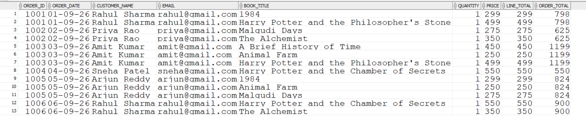
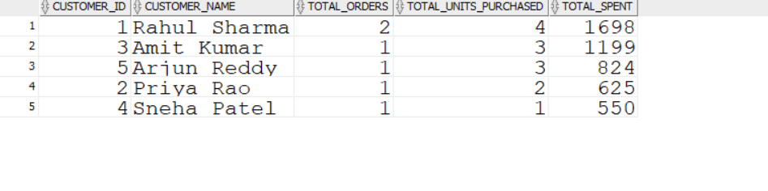
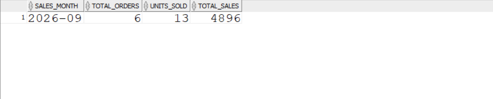

# Online Bookstore SQL Analysis

## Project Overview

The **Online Bookstore SQL Analysis** project uses Oracle SQL to analyze bookstore operations, customer purchasing behavior, order details, and sales performance. The project demonstrates SQL querying, data aggregation, table relationships, indexing, query validation, and business reporting.

The database contains six tables: `AUTHORS`, `GENRES`, `BOOKS`, `CUSTOMERS`, `ORDERS`, and `ORDER_DETAILS`.

## Objectives

- Analyze customer orders and purchasing patterns.
- Calculate total revenue, units sold, and average order value.
- Identify top-selling books and high-value customers.
- Generate monthly sales summaries.
- Validate stored order totals against calculated totals.
- Explore indexes, constraints, and query execution plans.

## Tools and Technologies

- **Database:** Oracle Database
- **SQL Environment:** Oracle SQL Developer
- **Query Language:** SQL
- **Concepts:** Joins, aggregate functions, subqueries, `GROUP BY`, `ORDER BY`, views, indexes, constraints, and data validation.

## Database Structure

| Table | Description |
|---|---|
| AUTHORS | Stores author information |
| GENRES | Stores book genre information |
| BOOKS | Stores book details and prices |
| CUSTOMERS | Stores customer details |
| ORDERS | Stores order dates, customer references, and stored order totals |
| ORDER_DETAILS | Stores books and quantities associated with each order |

## SQL Analysis Performed

### 1. Order Details Analysis

Combines orders, customers, order details, and books to display order IDs, dates, customer names, email addresses, book titles, quantities, prices, line totals, and stored order totals.

### 2. Customer Spending Analysis

Calculates the number of orders, total book units purchased, and total spending for each customer. Results are sorted by spending to identify high-value customers.

### 3. Monthly Sales Analysis

Groups sales by month and calculates the total number of orders, units sold, and sales revenue.

### 4. Top-Selling Books Analysis

Calculates units sold and total sales for each book to identify the best-performing titles.

### 5. Revenue and Business Metrics

Uses aggregate functions such as `COUNT()`, `SUM()`, and `AVG()` to calculate order counts, revenue, and average order value.

### 6. Data Validation

Compares the stored order total with the calculated total from book prices and quantities. A validation status identifies whether the values match.

### 7. Indexing and Query Execution Plans

Examines existing indexes and uses Oracle's execution plan facilities to understand how queries access tables and indexes.

### 8. Constraints and Relationships

Reviews primary key and foreign key constraints to understand relationships between tables and maintain referential integrity.

## Analysis Screenshots

### Order Details Analysis

Displays order IDs, order dates, customer names, email addresses, book titles, quantities, prices, line totals, and order totals.

### Customer Spending Analysis

Summarizes the number of orders, total book units purchased, and total spending for each customer.

### Monthly Sales Analysis

Displays monthly order counts, units sold, and total sales revenue.

## Key Findings

Based on the sample dataset currently used in the project:

- **Total orders:** 6
- **Total customers with orders:** 5
- **Total units sold:** 13
- **Total sales revenue:** 4,896
- **Top-selling book by units sold:** Harry Potter and the Chamber of Secrets
- **Highest-spending customer:** Rahul Sharma
- **Order total validation:** All six orders matched their calculated totals in the validation query.

*Note: These findings reflect the current sample data and may change if the database is updated.*

## Skills Demonstrated

- Oracle SQL querying
- Data retrieval and filtering
- Multi-table joins
- Data aggregation and grouping
- Sales and customer analysis
- Data validation and reconciliation
- Index inspection and execution plan analysis
- Database constraints and relationships
- Technical documentation using GitHub

## Repository Contents

- `Bookstore_Connection.sql` and related SQL files — SQL scripts created during the project.
- `bookstore_analysis_today.sql` and `bookstore_analysis_today0.sql` — Additional analysis scripts.
- `order_details_analysis.png` — Order details analysis screenshot.
- `customer_spending_analysis.png` — Customer spending analysis screenshot.
- `monthly_sales_analysis.png` — Monthly sales analysis screenshot.
- `README.md` — Project documentation.

## Conclusion

This project demonstrates how SQL can be used to analyze bookstore transactions, understand customer spending, measure sales performance, validate financial totals, and explore database performance concepts. It provides practical experience in relational database querying and business-oriented data analysis.

---

**Project Domain:** Retail / Sales Analytics  
**Database:** Oracle SQL  
**Author:** Tilak S Badami
